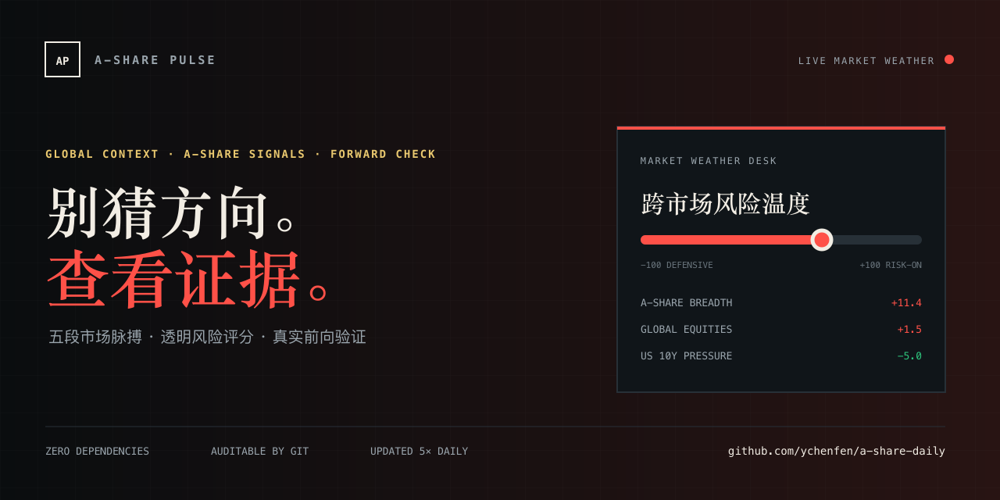
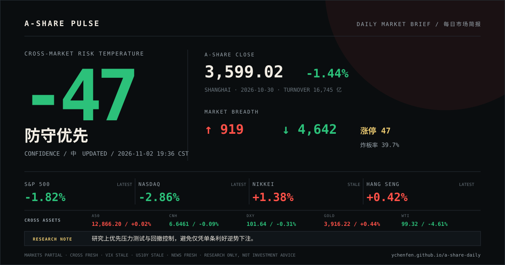
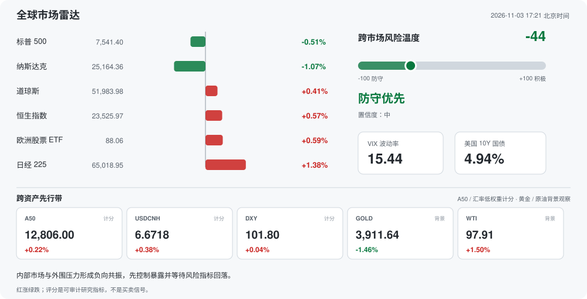
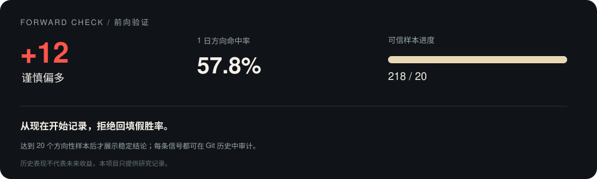
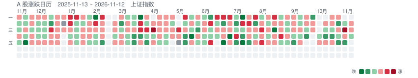
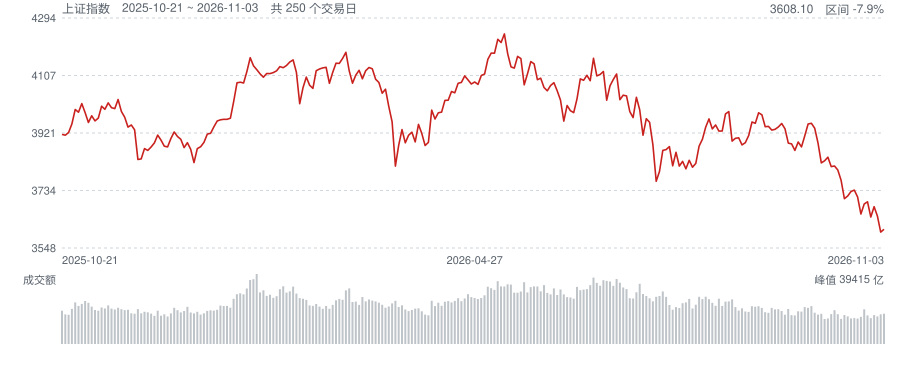
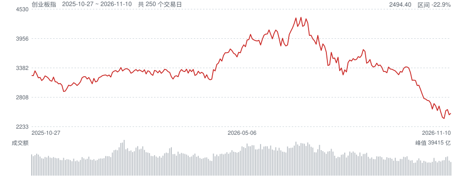

<div align="center">

# 📈 A-Share Pulse

**把 GitHub 提交图变成 A 股市场心电图。**

每天五次联动全球收盘、A 股盘中与新闻风险；零依赖、可审计、可直接 Fork。

<a href="https://github.com/ychenfen/a-share-daily/actions/workflows/daily.yml"></a>
<a href="https://ychenfen.github.io/a-share-daily/"></a>


<a href="LICENSE"></a>

[English](README.en.md) · 简体中文

</div>

<a href="https://ychenfen.github.io/a-share-daily/"></a>

> [!NOTE]
> **🟢 盘中** · 开盘脉搏已更新 · 最后检查 `2026-11-13 17:23`（北京时间）

[🌐 在线大屏](https://ychenfen.github.io/a-share-daily/) · [一键生成自己的版本](https://github.com/ychenfen/a-share-daily/generate) · [最新 JSON](data/latest.json) · [运行状态](data/status.json) · [完整历史](data/) · [数据字典](docs/DATA_SCHEMA.md) · [自动任务](https://github.com/ychenfen/a-share-daily/actions) · [讨论区](https://github.com/ychenfen/a-share-daily/discussions) · [路线图](ROADMAP.md) · [参与贡献](CONTRIBUTING.md)

## 为什么值得收藏

| 能力 | 你得到什么 |
| --- | --- |
| 🫀 五段市场脉搏 | 外围收盘 + A 股开盘、午间、收盘、夜间校验，不只是日终一个点 |
| 🧠 情绪温度计 | 涨跌家数、涨停/跌停、炸板率、最高连板和行业强弱 |
| 🟩 GitHub 风格日历 | 用红绿贡献格复刻近一年市场节奏，适合截图分享 |
| 🖥️ 在线研究大屏 | GitHub Pages 自动部署，手机和桌面都能直接查看 |
| 🌍 跨资产先行带 | A50、离岸人民币与美元指数低权重计分，黄金和原油保留为背景 |
| 🧭 事件传导链 | 新闻先去重分类，再映射宏观变量、A 股风格和可证伪条件 |
| 🗞️ 每日传播卡片 | 自动生成 1200×630 矢量简报，可下载、引用和转发 |
| 🧾 Git 原生数据湖 | 每次变化都有 diff，可追溯、可回滚，CSV/JSON 直接用于研究 |
| 🪶 零第三方依赖 | 只用 Python 标准库和 GitHub Actions，Fork 后无需服务器 |
| 🛡️ 质量门禁 | 每次推送前跑回归测试、schema 和重复日期检查 |

## 今日市场简报

<a href="https://ychenfen.github.io/a-share-daily/#share"></a>

[打开可交互大屏](https://ychenfen.github.io/a-share-daily/) · [下载 SVG](charts/daily_brief.svg)

## 全球市场与策略雷达



> **风险温度 -33 · 防守优先**（置信度：中）
> 内部市场与外围压力形成负向共振，先控制暴露并等待风险指标回落。

| 市场 | 地区 | 收盘 | 涨跌幅 |
| --- | --- | ---: | ---: |
| 标普 500 | 美国 | 7592.40 | -0.35% |
| 纳斯达克 | 美国 | 25366.09 | -0.39% |
| 道琼斯 | 美国 | 52297.09 | -0.36% |
| 恒生指数 | 中国香港 | 23637.60 | -1.55% |
| 欧洲股票 ETF | 欧洲（美股代理） | 88.91 | -0.61% |
| 日经 225 | 日本 | 65018.95 | +1.38% |

### 跨资产先行带

> A50 与美元/人民币组合仅作低权重评分；黄金和原油只提供风险背景，不直接加减分。

| 资产 | 角色 | 最新值 | 涨跌幅 | 状态 |
| --- | --- | ---: | ---: | --- |
| 富时中国 A50 期货 | 低权重计分 | 12,834.90 | +0.04% | 最新 |
| 美元兑离岸人民币 | 低权重计分 | 6.6721 | -0.00% | 最新 |
| 美元指数 | 低权重计分 | 103.16 | -0.01% | 最新 |
| COMEX 黄金 | 背景观察 | 3,898.57 | +0.34% | 最新 |
| WTI 原油 | 背景观察 | 88.54 | -0.23% | 最新 |

> ⚠️ 数据降级：全球指数、VIX、美债10Y本轮未完全刷新，已尽量保留最近有效值。

### 风险温度拆解

| 信号 | 当前值 | 分数贡献 | 解释 |
| --- | --- | ---: | --- |
| A股动量 | 上证 -0.67% | -5.4 | 反映本地市场价格强弱 |
| 市场宽度 | 涨 883 / 跌 4694 | -13.7 | 上涨家数占优时提高风险偏好 |
| 短线情绪 | 涨停 37 / 跌停 5 / 炸板率 48.6% | -0.7 | 涨停扩散加分，炸板率过高扣分 |
| 外围股市 | 6 个市场均值 -0.31% | -2.2 | 衡量隔夜风险偏好共振 |
| A50 先行 | 富时 A50 +0.04% | +0.2 | 离岸期货只作低权重先行确认，避免重复计算 A 股现货动量 |
| 美元与人民币 | USD/CNH 6.6721 (-0.00%) / DXY 103.16 (-0.01%) | +0.1 | 美元走弱与人民币走强通常缓解外部流动性压力 |
| 波动压力 | VIX 15.44 | +0.0 | VIX 越高，全球避险需求通常越强 |
| 利率压力 | 美债 10Y 4.94% | -5.0 | 长端利率偏高时压制高估值资产 |
| 新闻语气 | 正向词 0 / 风险词 3 | -6.0 | 标题关键词只做低权重提示，不代替事实核验 |

### 事件传导链

> 去重标题只作为待验证线索；分类数量不是已确认事件，传导链也不直接参与评分。

| 事件线索 | 宏观传导 | A 股映射 | 观察指标 | 失效条件 |
| --- | --- | --- | --- | --- |
| 央行与利率（2 条） | 政策利率预期 → 美债收益率与美元 → 全球流动性 | 高估值成长、券商、地产与人民币敏感资产 | 美债10Y 4.94%（最近有效值） / 美元指数 103.16 / -0.01%（最新） / USD/CNH 6.6721 / -0.00%（最新） | 失效条件：若美债利率、美元与人民币没有同向确认，标题冲击可能只是短期噪音。 |
| 通胀与就业（2 条） | 通胀与就业数据 → 降息路径与实际利率 → 估值折现率 | 成长估值、可选消费、资源品与利率敏感板块 | 美债10Y 4.94%（最近有效值） / 美元指数 103.16 / -0.01%（最新） / 纳斯达克 25,366.09 / -0.39%（最新） | 失效条件：若实际利率与美元反向运行，单条数据不应直接外推为持续风格切换。 |

### 研究观察

- 研究上优先压力测试与回撤控制，避免仅凭单条利好逆势下注。

### 新闻雷达

- [通胀超预期点燃美联储加息预期！对冲基金重启做空交易利率敏感型股票再成目标_滚动新闻_财经](https://news.google.com/rss/articles/CBMiYEFVX3lxTE83RVlDbnNuR0pPNVVoODJkYkI3LTdFaTJLeUxQMy16VHhHSENnamRobHF1WXRPbzdlWDFuc3FmZmRfTzRSTTk4MFF4RzBvNzkwUDE4aFdVT1hJeXFlaWhOYQ?oc=5) · 证券之星
- [CPI砸崩美债！华尔街将美联储“暴力加息”纳入定价](https://news.google.com/rss/articles/CBMiSEFVX3lxTFB0SXpjVU56d01PeWRkTkdvZGRMSFJEc1A1UWQ3aHBBTENfUUtPS2R6dU9uWXdKZ1l4d0pFZk5uZHJ0dFRuZjdPTQ?oc=5) · 财联社

方法：透明规则评分：A股动量、市场宽度、短线情绪、外围股市、A50先行、美元与人民币、VIX、美债10Y和新闻标题低权重语气；黄金与原油只作背景，事件传导链不直接计分。

> 这是可审计的通用市场研究提示，不是个性化仓位或买卖建议。

## 信号成绩单



> 1 日方向命中率 **56.8%**，当前有效样本 **229** 条。

方法：开盘/午间信号验证当日收盘，收盘/夜间信号验证下一交易日；同时持续结算 3 日和 5 日复合收益。

> 样本不足时不输出稳定性结论，历史表现也不代表未来收益。

## 走势







## 最近 10 个交易日

| 日期 | 上证 | 深成 | 创业板 | 沪深300 | 科创50 | 成交额(亿) | 涨/跌/平 | 涨停 | 跌停 |
| --- | --- | --- | --- | --- | --- | --- | --- | --- | --- |
| 2026-11-12 | 3655.83<br>-0.67% | 11197.98<br>-1.68% | 2509.43<br>-2.44% | 4043.93<br>-0.78% | 1309.84<br>+0.73% | 19321 | 883/4694/73 | 37 | 5 |
| 2026-11-11 | 3680.64<br>+0.46% | 11389.74<br>+1.32% | 2572.07<br>+3.11% | 4075.71<br>+0.41% | 1300.38<br>+2.80% | 16763 | 3572/1856/223 | 85 | 0 |
| 2026-11-10 | 3663.72<br>+0.08% | 11241.54<br>+0.86% | 2494.40<br>+1.46% | 4059.11<br>+0.07% | 1265.02<br>+0.64% | 15048 | 4305/1177/168 | 93 | 0 |
| 2026-11-06 | 3649.18<br>-1.10% | 11175.78<br>-2.57% | 2465.23<br>-3.96% | 4054.28<br>-1.44% | 1253.20<br>-2.60% | 16578 | 767/4793/90 | 32 | 15 |
| 2026-11-05 | 3689.91<br>+0.10% | 11471.09<br>+1.19% | 2566.80<br>+0.87% | 4113.41<br>+0.29% | 1286.68<br>+1.68% | 21180 | -/-/- | 84 | 0 |
| 2026-11-04 | 3686.17<br>+2.16% | 11335.69<br>+4.22% | 2544.73<br>+6.40% | 4101.34<br>+2.31% | 1265.47<br>+9.92% | 20377 | 4732/786/131 | 118 | 10 |
| 2026-11-03 | 3608.10<br>-0.82% | 10876.99<br>-1.21% | 2391.65<br>-2.73% | 4008.87<br>-0.20% | 1151.28<br>-3.81% | 17034 | 2152/3329/166 | 48 | 17 |
| 2026-10-30 | 3599.02<br>-1.44% | 10833.78<br>-2.73% | 2413.63<br>-4.13% | 3985.50<br>-1.39% | 1160.84<br>-5.48% | 16745 | 919/4642/87 | 47 | 82 |
| 2026-10-29 | 3651.43<br>-0.82% | 11138.20<br>-2.92% | 2517.59<br>-4.45% | 4041.84<br>-1.03% | 1228.09<br>-4.27% | 15565 | 789/4795/63 | 39 | 41 |
| 2026-10-28 | 3681.47<br>+0.91% | 11473.18<br>+2.02% | 2634.76<br>+3.40% | 4083.87<br>+0.85% | 1282.93<br>+2.45% | 16285 | 4189/1270/188 | 72 | 5 |

完整历史在 [data/](data/) 目录，共 689 个交易日。

## 市场情绪

最新交易日 2026-11-12：

- 涨停 **37** 家，跌停 **5** 家
- 炸板 35 家，炸板率 **48.6%**（越高说明封板越不牢）
- 最高 **17** 连板，2 板及以上共 17 家

| 日期 | 涨停 | 跌停 | 炸板 | 炸板率 | 最高连板 | 连板家数 |
| --- | --- | --- | --- | --- | --- | --- |
| 2026-11-12 | 37 | 5 | 35 | 48.6% | 17 | 17 |
| 2026-11-11 | 85 | 0 | 19 | 18.3% | 16 | 24 |
| 2026-11-10 | 93 | 0 | 19 | 17.0% | 15 | 33 |
| 2026-11-06 | 32 | 15 | 14 | 30.4% | 13 | 15 |
| 2026-11-05 | 84 | 0 | 48 | 36.4% | 12 | 28 |
| 2026-11-04 | 118 | 10 | 33 | 21.9% | 8 | 22 |
| 2026-11-03 | 48 | 17 | 34 | 41.5% | 18 | 19 |
| 2026-10-30 | 47 | 82 | 31 | 39.7% | 8 | 11 |
| 2026-10-29 | 39 | 41 | 25 | 39.1% | 7 | 12 |
| 2026-10-28 | 72 | 5 | 69 | 48.9% | 14 | 12 |

## 行业板块

2026-11-12 领涨与领跌各五个：

| | 行业 | 涨跌幅 | 主力净流入(亿) | 领涨股 |
| --- | --- | --- | --- | --- |
| 领涨 | 水产养殖 | +4.15% | 0.77 | 好当家 |
|  | 地面兵装Ⅲ | +3.19% | 5.38 | 长城军工 |
|  | 地面兵装Ⅱ | +3.19% | 5.38 | 长城军工 |
|  | 卫浴电器 | +2.80% | -2.78 | 日出东方 |
|  | 百货 | +2.70% | 0.02 | 广百股份 |
| 领跌 | 视频媒体 | -9.54% | -5.23 | 芒果超媒 |
|  | 其他数字媒体 | -8.78% | -5.32 | 风语筑 |
|  | 文字媒体 | -7.04% | -5.45 | 掌阅科技 |
|  | 黄金 | -6.37% | -13.24 | 恒邦股份 |
|  | 贵金属 | -6.15% | -17.87 | 恒邦股份 |

## 自动更新节奏

| 北京时间 | 记录内容 | 正式日线 |
| --- | --- | --- |
| 06:15 | 外围收盘：美股、日股、港股、VIX、美债与新闻 | 否 |
| 10:05 | 开盘脉搏：指数、成交额、涨跌家数 | 否 |
| 11:35 | 午间脉搏：上午收束状态 | 否 |
| 15:10 | 收盘快照：完整行情、情绪和行业排行 | 是 |
| 20:20 | 夜间校验：复核收盘数据与数据源健康 | 是 |

GitHub Actions 可能有数分钟调度延迟。休市日不会伪造行情，只刷新状态和审计日志。

## 数据与复用

```text
data/YYYY.csv          # 日线与收盘情绪，适合回测
data/pulses/YYYY-MM.csv # 日内四段观察，适合研究盘中演化
data/sectors.csv        # 行业领涨/领跌 Top 5
data/global.json         # 全球指数、A50、汇率、美元、黄金、原油、VIX 与美债
data/analysis.json       # 可解释风险温度、新闻与研究观察
data/scorecard.json      # 真实运行信号的前向验证成绩单
data/signals/YYYY.csv    # 每次风险信号的可审计原始记录
data/latest.json        # 程序最方便消费的聚合入口
data/status.json        # 最近任务与数据源健康状态
```

本地运行不需要安装依赖：

```bash
python3 scripts/snapshot.py
python3 scripts/global_context.py
python3 scripts/scorecard.py
python3 scripts/share_card.py
python3 scripts/chart.py
python3 -m unittest discover -s tests -v
python3 scripts/validate.py
```

想拥有自己的市场心电图，直接用模板生成仓库并开启 Actions 即可。更多字段说明见 [数据字典](docs/DATA_SCHEMA.md)。

## 数据来源与边界

指数行情来自腾讯行情公开接口；市场宽度、涨跌停池和行业排行来自东方财富公开接口。接口异常时保留上一份有效数据，并在 `status.json` 明确标记，不把空响应冒充成功。

全球指数来自腾讯公开行情，A50、离岸人民币、美元指数、黄金与原油来自新浪财经公开行情，宏观压力来自 FRED；新闻区只保留Google News RSS 的标题、来源和链接，不抓取或改写正文。

指数历史由 [scripts/backfill.py](scripts/backfill.py) 一次性回填。涨跌家数、涨停跌停、连板梯队这些是盘后快照，没有历史接口可回填，只能逐日累积，所以回填日期的这几列是空的。

> 本项目仅用于数据记录与技术研究，不构成投资建议。公开接口可能调整，请以交易所和数据服务商正式口径为准。

---

如果它帮你省下了整理行情的时间，欢迎点一个 ⭐。想一起完善信号、数据源或可视化，可以先到 [讨论区](https://github.com/ychenfen/a-share-daily/discussions) 交流，或从 [贡献指南](CONTRIBUTING.md) 开始。
