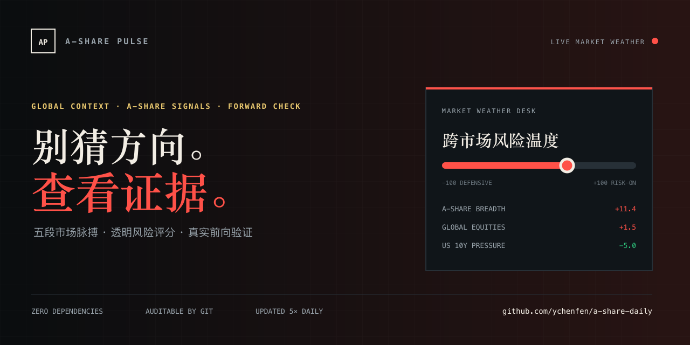
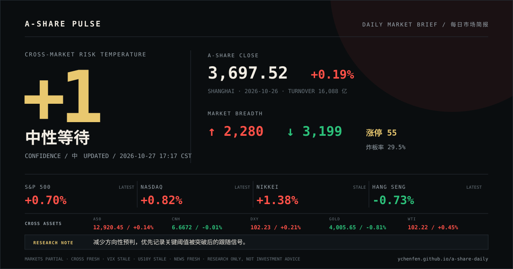
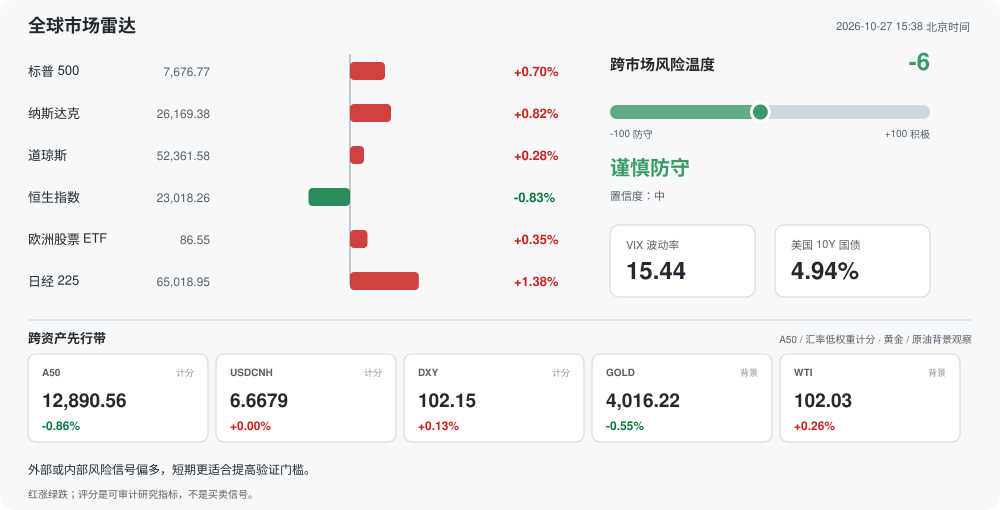
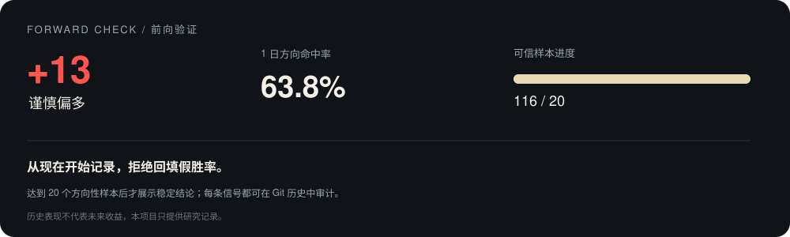
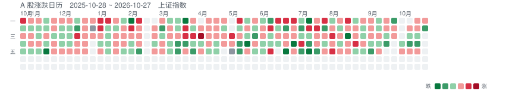
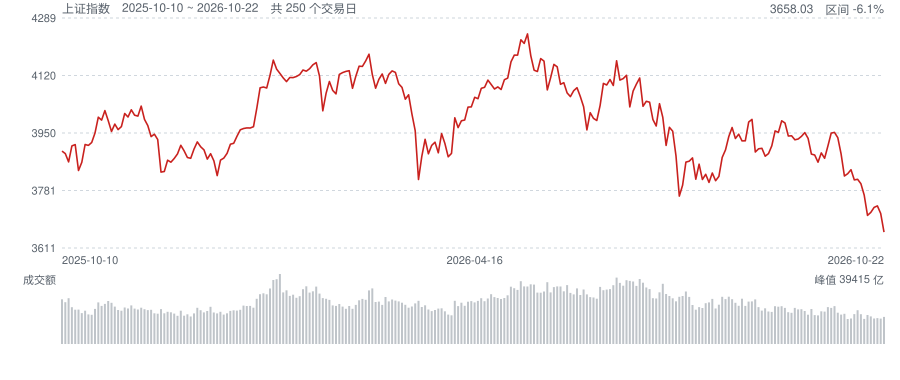
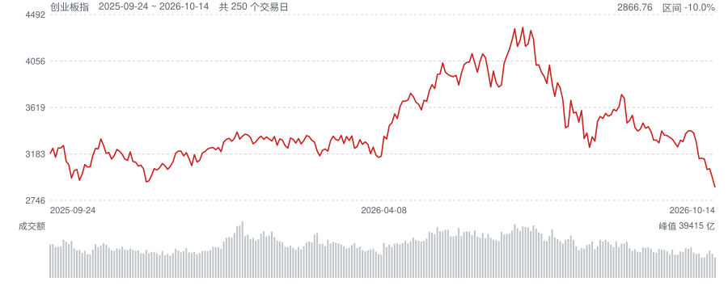

<div align="center">

# 📈 A-Share Pulse

**把 GitHub 提交图变成 A 股市场心电图。**

每天五次联动全球收盘、A 股盘中与新闻风险；零依赖、可审计、可直接 Fork。

<a href="https://github.com/ychenfen/a-share-daily/actions/workflows/daily.yml"></a>
<a href="https://ychenfen.github.io/a-share-daily/"></a>


<a href="LICENSE"></a>

[English](README.en.md) · 简体中文

</div>

<a href="https://ychenfen.github.io/a-share-daily/"></a>

> [!NOTE]
> **⚪ 休市 / 未开盘** · 目标日未开市或尚未产生行情，最近交易日 2026-10-30 · 最后检查 `2026-10-31 17:54`（北京时间）

[🌐 在线大屏](https://ychenfen.github.io/a-share-daily/) · [一键生成自己的版本](https://github.com/ychenfen/a-share-daily/generate) · [最新 JSON](data/latest.json) · [运行状态](data/status.json) · [完整历史](data/) · [数据字典](docs/DATA_SCHEMA.md) · [自动任务](https://github.com/ychenfen/a-share-daily/actions) · [讨论区](https://github.com/ychenfen/a-share-daily/discussions) · [路线图](ROADMAP.md) · [参与贡献](CONTRIBUTING.md)

## 为什么值得收藏

| 能力 | 你得到什么 |
| --- | --- |
| 🫀 五段市场脉搏 | 外围收盘 + A 股开盘、午间、收盘、夜间校验，不只是日终一个点 |
| 🧠 情绪温度计 | 涨跌家数、涨停/跌停、炸板率、最高连板和行业强弱 |
| 🟩 GitHub 风格日历 | 用红绿贡献格复刻近一年市场节奏，适合截图分享 |
| 🖥️ 在线研究大屏 | GitHub Pages 自动部署，手机和桌面都能直接查看 |
| 🌍 跨资产先行带 | A50、离岸人民币与美元指数低权重计分，黄金和原油保留为背景 |
| 🧭 事件传导链 | 新闻先去重分类，再映射宏观变量、A 股风格和可证伪条件 |
| 🗞️ 每日传播卡片 | 自动生成 1200×630 矢量简报，可下载、引用和转发 |
| 🧾 Git 原生数据湖 | 每次变化都有 diff，可追溯、可回滚，CSV/JSON 直接用于研究 |
| 🪶 零第三方依赖 | 只用 Python 标准库和 GitHub Actions，Fork 后无需服务器 |
| 🛡️ 质量门禁 | 每次推送前跑回归测试、schema 和重复日期检查 |

## 今日市场简报

<a href="https://ychenfen.github.io/a-share-daily/#share"></a>

[打开可交互大屏](https://ychenfen.github.io/a-share-daily/) · [下载 SVG](charts/daily_brief.svg)

## 全球市场与策略雷达



> **风险温度 -48 · 防守优先**（置信度：中）
> 内部市场与外围压力形成负向共振，先控制暴露并等待风险指标回落。

| 市场 | 地区 | 收盘 | 涨跌幅 |
| --- | --- | ---: | ---: |
| 标普 500 | 美国 | 7580.07 | -1.82% |
| 纳斯达克 | 美国 | 25437.00 | -2.86% |
| 道琼斯 | 美国 | 51770.31 | -1.09% |
| 恒生指数 | 中国香港 | 23294.42 | +1.46% |
| 欧洲股票 ETF | 欧洲（美股代理） | 87.54 | -0.68% |
| 日经 225 | 日本 | 65018.95 | +1.38% |

### 跨资产先行带

> A50 与美元/人民币组合仅作低权重评分；黄金和原油只提供风险背景，不直接加减分。

| 资产 | 角色 | 最新值 | 涨跌幅 | 状态 |
| --- | --- | ---: | ---: | --- |
| 富时中国 A50 期货 | 低权重计分 | 12,816.72 | +0.06% | 最新 |
| 美元兑离岸人民币 | 低权重计分 | 6.6528 | -0.05% | 最新 |
| 美元指数 | 低权重计分 | 101.97 | +0.06% | 最新 |
| COMEX 黄金 | 背景观察 | 3,884.28 | -3.65% | 最新 |
| WTI 原油 | 背景观察 | 102.91 | +0.89% | 最新 |

> ⚠️ 数据降级：全球指数、VIX、美债10Y本轮未完全刷新，已尽量保留最近有效值。

### 风险温度拆解

| 信号 | 当前值 | 分数贡献 | 解释 |
| --- | --- | ---: | --- |
| A股动量 | 上证 -1.44% | -11.5 | 反映本地市场价格强弱 |
| 市场宽度 | 涨 919 / 跌 4642 | -13.4 | 上涨家数占优时提高风险偏好 |
| 短线情绪 | 涨停 47 / 跌停 82 / 炸板率 39.7% | -10.8 | 涨停扩散加分，炸板率过高扣分 |
| 外围股市 | 6 个市场均值 -0.60% | -4.2 | 衡量隔夜风险偏好共振 |
| A50 先行 | 富时 A50 +0.06% | +0.4 | 离岸期货只作低权重先行确认，避免重复计算 A 股现货动量 |
| 美元与人民币 | USD/CNH 6.6528 (-0.05%) / DXY 101.97 (+0.06%) | +0.3 | 美元走弱与人民币走强通常缓解外部流动性压力 |
| 波动压力 | VIX 15.44 | +0.0 | VIX 越高，全球避险需求通常越强 |
| 利率压力 | 美债 10Y 4.94% | -5.0 | 长端利率偏高时压制高估值资产 |
| 新闻语气 | 正向词 0 / 风险词 2 | -4.0 | 标题关键词只做低权重提示，不代替事实核验 |

### 事件传导链

> 去重标题只作为待验证线索；分类数量不是已确认事件，传导链也不直接参与评分。

| 事件线索 | 宏观传导 | A 股映射 | 观察指标 | 失效条件 |
| --- | --- | --- | --- | --- |
| 商品与成本（2 条） | 商品价格 → 输入成本与通胀预期 → 企业利润分配 | 能源、化工、有色、航空运输与中下游成本敏感行业 | 原油 102.91 / +0.89%（最新） / 黄金 3,884.28 / -3.65%（最新） / 美债10Y 4.94%（最近有效值） | 失效条件：若现货代理价格未确认标题方向，暂不推断产业链利润迁移。 |
| 美元与人民币（2 条） | 美元与人民币 → 跨境流动性及进口成本 → 外资风险偏好 | 外资敏感权重、航空造纸、出口链与离岸中国资产 | 美元指数 101.97 / +0.06%（最新） / USD/CNH 6.6528 / -0.05%（最新） / 富时A50 12,816.72 / +0.06%（最新） | 失效条件：若 DXY 与 USD/CNH 背离，不能把单一汇率波动解释成统一资金方向。 |
| 科技与产业（1 条） | 科技盈利与估值 → 全球成长风格 → 风险偏好扩散 | 半导体、算力、通信与其他高估值成长方向 | 纳斯达克 25,437.00 / -2.86%（最新） / 富时A50 12,816.72 / +0.06%（最新） / 美债10Y 4.94%（最近有效值） | 失效条件：若纳指走弱、A50 不确认或长端利率继续上行，主题热度不等于趋势。 |

### 研究观察

- 研究上优先压力测试与回撤控制，避免仅凭单条利好逆势下注。

### 新闻雷达

- [全球市场遭遇“黑色星期五”！黄金跌破3900美元、白银暴跌逾6%、英特尔崩跌28%，一场更大的风暴正在酝酿？](https://news.google.com/rss/articles/CBMiY0FVX3lxTE51VVZRa2xpWDZST3E5SnJqc2xKaEZGWTVwc2FrWWt6Y2t1ODFqNTN2UTRjX1Z0OUFWS2xlbFplWTNiUHVRTDBJek95N3NhM19aTXZrWnktZUVtZjBuMnFrdVgzMA?oc=5) · 金融界
- [美股投资必备！8月重磅大事抢先看，这些影响涨跌的日子都圈出来了](https://news.google.com/rss/articles/CBMimwFBVV95cUxOeHhNenBXMGVZcWRSNnMtQkw2SFh1TzhJOUFUdWtHVl9sUGI3WG5aZHNZdmZVUkN3R3JjMG85N09vSi1sWDIzckhOUHZZS1lHWmNMTWkwSVh5VGc1X3A4NzdhNVJ2bmh1M1Z1d1p1ZEhOSDYxVnpiaXdOelNCd29LWDNfWXVvdk5OcXduS3lIQmlRMm90NjFVU0tMZw?oc=5) · 富途牛牛
- [科技股抛售潮蔓延至贵金属！黄金创一年新低，白银失守50美元](https://news.google.com/rss/articles/CBMioAFBVV95cUxQT3BiYTBBeXhrNHhJYy0zX2thd1BQZWdNN0tETDY3VDV0RFNUTWNIMk41VEluVHhyM0k5M1dOTDlXdmhOSXR6QVkwUXVJckRNa2hIZ1Z5dGFEeXVUUFdTWkpSNEZIX3M2U181aFN0ckc4Z2w3eTRPaFpTN2dQUklOdlRPVURfNWZHYVplS3YxUFZPWU5EamxzNFR5dHFNZ3NC?oc=5) · 富途牛牛

方法：透明规则评分：A股动量、市场宽度、短线情绪、外围股市、A50先行、美元与人民币、VIX、美债10Y和新闻标题低权重语气；黄金与原油只作背景，事件传导链不直接计分。

> 这是可审计的通用市场研究提示，不是个性化仓位或买卖建议。

## 信号成绩单



> 1 日方向命中率 **60.4%**，当前有效样本 **164** 条。

方法：开盘/午间信号验证当日收盘，收盘/夜间信号验证下一交易日；同时持续结算 3 日和 5 日复合收益。

> 样本不足时不输出稳定性结论，历史表现也不代表未来收益。

## 走势







## 最近 10 个交易日

| 日期 | 上证 | 深成 | 创业板 | 沪深300 | 科创50 | 成交额(亿) | 涨/跌/平 | 涨停 | 跌停 |
| --- | --- | --- | --- | --- | --- | --- | --- | --- | --- |
| 2026-10-30 | 3599.02<br>-1.44% | 10833.78<br>-2.73% | 2413.63<br>-4.13% | 3985.50<br>-1.39% | 1160.84<br>-5.48% | 16745 | 919/4642/87 | 47 | 82 |
| 2026-10-29 | 3651.43<br>-0.82% | 11138.20<br>-2.92% | 2517.59<br>-4.45% | 4041.84<br>-1.03% | 1228.09<br>-4.27% | 15565 | 789/4795/63 | 39 | 41 |
| 2026-10-28 | 3681.47<br>+0.91% | 11473.18<br>+2.02% | 2634.76<br>+3.40% | 4083.87<br>+0.85% | 1282.93<br>+2.45% | 16285 | 4189/1270/188 | 72 | 5 |
| 2026-10-27 | 3648.30<br>-1.33% | 11245.73<br>-2.50% | 2548.15<br>-3.41% | 4049.55<br>-1.32% | 1252.28<br>-4.81% | 14610 | 624/4974/49 | 41 | 22 |
| 2026-10-26 | 3697.52<br>+0.19% | 11534.38<br>-1.19% | 2638.23<br>-1.71% | 4103.54<br>-0.04% | 1315.50<br>-2.23% | 16088 | 2280/3199/168 | 55 | 26 |
| 2026-10-23 | 3690.48<br>+0.89% | 11673.83<br>+2.79% | 2684.10<br>+4.16% | 4105.33<br>+1.71% | 1345.51<br>+3.04% | 19563 | 4568/935/146 | 82 | 6 |
| 2026-10-22 | 3658.03<br>-1.48% | 11357.32<br>-2.96% | 2576.90<br>-4.37% | 4036.30<br>-1.84% | 1305.87<br>-2.78% | 15287 | 537/5071/39 | 33 | 49 |
| 2026-10-21 | 3713.03<br>-0.60% | 11704.35<br>-0.82% | 2694.71<br>-1.62% | 4111.93<br>-0.97% | 1343.28<br>+0.06% | 14294 | 2007/3401/237 | 50 | 5 |
| 2026-10-20 | 3735.37<br>+0.12% | 11801.29<br>-0.14% | 2739.20<br>-0.26% | 4152.11<br>-0.54% | 1342.42<br>+1.00% | 14561 | 3801/1706/138 | 54 | 6 |
| 2026-10-19 | 3730.92<br>+0.39% | 11817.42<br>+0.13% | 2746.29<br>-0.94% | 4174.53<br>+0.09% | 1329.19<br>-2.17% | 14375 | 2302/3161/178 | 46 | 22 |

完整历史在 [data/](data/) 目录，共 682 个交易日。

## 市场情绪

最新交易日 2026-10-30：

- 涨停 **47** 家，跌停 **82** 家
- 炸板 31 家，炸板率 **39.7%**（越高说明封板越不牢）
- 最高 **8** 连板，2 板及以上共 11 家

| 日期 | 涨停 | 跌停 | 炸板 | 炸板率 | 最高连板 | 连板家数 |
| --- | --- | --- | --- | --- | --- | --- |
| 2026-10-30 | 47 | 82 | 31 | 39.7% | 8 | 11 |
| 2026-10-29 | 39 | 41 | 25 | 39.1% | 7 | 12 |
| 2026-10-28 | 72 | 5 | 69 | 48.9% | 14 | 12 |
| 2026-10-27 | 41 | 22 | 28 | 40.6% | 8 | 17 |
| 2026-10-26 | 55 | 26 | 23 | 29.5% | 12 | 18 |
| 2026-10-23 | 82 | 6 | 12 | 12.8% | 16 | 20 |
| 2026-10-22 | 33 | 49 | 23 | 41.1% | 10 | 11 |
| 2026-10-21 | 50 | 5 | 19 | 27.5% | 13 | 22 |
| 2026-10-20 | 54 | 6 | 29 | 34.9% | 12 | 20 |
| 2026-10-19 | 46 | 22 | 21 | 31.3% | 21 | 14 |

## 行业板块

2026-10-30 领涨与领跌各五个：

| | 行业 | 涨跌幅 | 主力净流入(亿) | 领涨股 |
| --- | --- | --- | --- | --- |
| 领涨 | 白酒Ⅲ | +5.15% | 25.00 | 迎驾贡酒 |
|  | 白酒Ⅱ | +5.15% | 25.00 | 迎驾贡酒 |
|  | 纺织鞋类制造 | +3.87% | 0.35 | 华利集团 |
|  | 综合电商 | +3.51% | 0.03 | ST易购 |
|  | 医疗研发外包 | +3.37% | 14.39 | 万邦医药 |
| 领跌 | 文字媒体 | -9.90% | -3.73 | 中文在线 |
|  | 其他数字媒体 | -9.01% | -1.77 | 凡拓数创 |
|  | 门户网站 | -8.40% | -3.13 | 返利科技 |
|  | 数字媒体 | -8.36% | -9.70 | 芒果超媒 |
|  | 钴 | -8.14% | -0.53 | 寒锐钴业 |

## 自动更新节奏

| 北京时间 | 记录内容 | 正式日线 |
| --- | --- | --- |
| 06:15 | 外围收盘：美股、日股、港股、VIX、美债与新闻 | 否 |
| 10:05 | 开盘脉搏：指数、成交额、涨跌家数 | 否 |
| 11:35 | 午间脉搏：上午收束状态 | 否 |
| 15:10 | 收盘快照：完整行情、情绪和行业排行 | 是 |
| 20:20 | 夜间校验：复核收盘数据与数据源健康 | 是 |

GitHub Actions 可能有数分钟调度延迟。休市日不会伪造行情，只刷新状态和审计日志。

## 数据与复用

```text
data/YYYY.csv          # 日线与收盘情绪，适合回测
data/pulses/YYYY-MM.csv # 日内四段观察，适合研究盘中演化
data/sectors.csv        # 行业领涨/领跌 Top 5
data/global.json         # 全球指数、A50、汇率、美元、黄金、原油、VIX 与美债
data/analysis.json       # 可解释风险温度、新闻与研究观察
data/scorecard.json      # 真实运行信号的前向验证成绩单
data/signals/YYYY.csv    # 每次风险信号的可审计原始记录
data/latest.json        # 程序最方便消费的聚合入口
data/status.json        # 最近任务与数据源健康状态
```

本地运行不需要安装依赖：

```bash
python3 scripts/snapshot.py
python3 scripts/global_context.py
python3 scripts/scorecard.py
python3 scripts/share_card.py
python3 scripts/chart.py
python3 -m unittest discover -s tests -v
python3 scripts/validate.py
```

想拥有自己的市场心电图，直接用模板生成仓库并开启 Actions 即可。更多字段说明见 [数据字典](docs/DATA_SCHEMA.md)。

## 数据来源与边界

指数行情来自腾讯行情公开接口；市场宽度、涨跌停池和行业排行来自东方财富公开接口。接口异常时保留上一份有效数据，并在 `status.json` 明确标记，不把空响应冒充成功。

全球指数来自腾讯公开行情，A50、离岸人民币、美元指数、黄金与原油来自新浪财经公开行情，宏观压力来自 FRED；新闻区只保留Google News RSS 的标题、来源和链接，不抓取或改写正文。

指数历史由 [scripts/backfill.py](scripts/backfill.py) 一次性回填。涨跌家数、涨停跌停、连板梯队这些是盘后快照，没有历史接口可回填，只能逐日累积，所以回填日期的这几列是空的。

> 本项目仅用于数据记录与技术研究，不构成投资建议。公开接口可能调整，请以交易所和数据服务商正式口径为准。

---

如果它帮你省下了整理行情的时间，欢迎点一个 ⭐。想一起完善信号、数据源或可视化，可以先到 [讨论区](https://github.com/ychenfen/a-share-daily/discussions) 交流，或从 [贡献指南](CONTRIBUTING.md) 开始。
